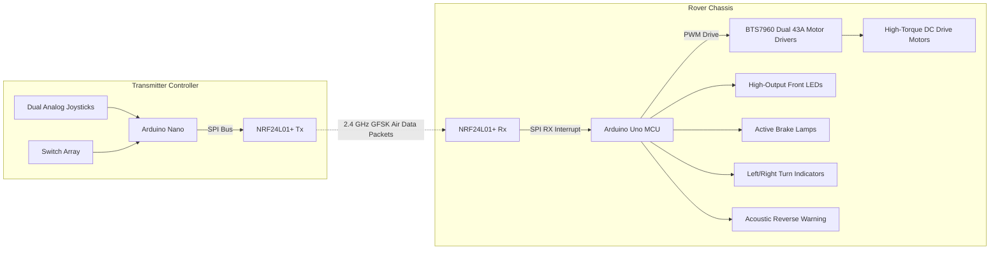

# 2.4 GHz NRF24L01+ RF Telemetry Robot Rover: High-Current BTS7960 Drive with Dynamic Indicator & Hazard Lighting

[-green.svg?style=for-the-badge)]()

> **Competitive Robotics Project | Graphic Era Hill University (B.Tech ECE 2023–2027)**  
> **Author:** Parth Dalakoti (*President, Robotics & Automation Club, GEHU*)  
> **Contact:** `parthdalakoti482@gmail.com` | [LinkedIn](https://linkedin.com/in/parthdalakoti)

---

## ⚡ Executive Summary

Derived from competition-proven combat robotics engineering (combining lessons from **5th place in RoboWar** and **6th place in RoboRace**), this repository implements a heavy-duty **2.4 GHz RF Telemetry Robotic Rover**:
1. **SPI RF Communication:** Uses Nordic **NRF24L01+ transceivers** with power-amplifier modules over high-speed hardware SPI with packet checksums and auto-acknowledgment.
2. **High-Power BTS7960 H-Bridge Drive:** Controls high-torque geared DC drive motors capable of sustaining up to 43A peak current with smooth PWM slew-rate limiting.
3. **Automotive Lighting Telemetry:** Synchronous driving lights including progressive turn signals, active brake lamps on deceleration, hazard flashers, and acoustic reverse beepers.

---

## ⚙️ System Architecture

---

## 🛠️ Bill of Materials (BOM)

| Component | Part / Spec | Voltage | Interface | Function |
| :--- | :--- | :--- | :--- | :--- |
| **Microcontroller** | Arduino Uno / Nano (ATmega328P) | 5V DC | SPI, PWM, GPIO | Telemetry decoding & motor control |
| **RF Module** | NRF24L01+ with SMA Antenna | 3.3V (with 5V adapter) | Hardware SPI (10MHz) | Long-range 2.4 GHz RF link |
| **Motor Driver** | BTS7960 Dual H-Bridge Module | 6V - 27V (43A Max) | PWM (IS, EN, IN) | High-current DC traction drive |
| **Power Storage** | 3S LiPo Battery (11.1V, 2200mAh 30C) | 11.1V Nominal | High-current XT60 | Motor and logic high-drain power |

---

## 🔌 Hardware Pinout Mapping

| Arduino Pin | Peripheral Connection | Function |
| :--- | :--- | :--- |
| **D9** | NRF24L01+ CE | Chip Enable RF mode |
| **D10** | NRF24L01+ CSN | Chip Select Not (SPI) |
| **D11** | NRF24L01+ MOSI | Master Out Slave In |
| **D12** | NRF24L01+ MISO | Master In Slave Out |
| **D13** | NRF24L01+ SCK | SPI Serial Clock |
| **D5 / D6** | BTS7960 Left Motor PWM | Left traction speed & direction |
| **D7 / D8** | BTS7960 Right Motor PWM | Right traction speed & direction |
| **A0 / A1** | Left & Right Turn LEDs | Directional turn indicators |
| **A2** | Reverse Buzzer + Brake LED | Active braking & reverse warning |

---

## 👨‍💻 Engineering Author
**Parth Dalakoti**  
*B.Tech in Electronics & Communication Engineering (2023–2027)*  
*Graphic Era Hill University (GEHU), Bhimtal Campus*  
*President, Robotics & Automation Club, GEHU*
